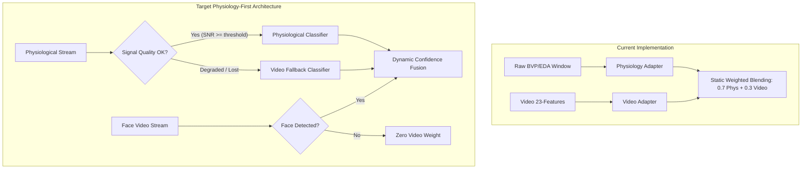
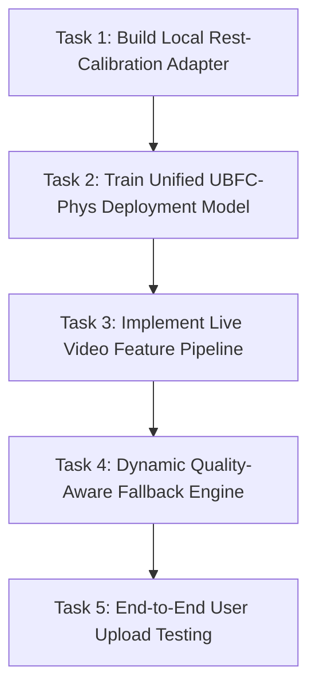

# Phase 1 Project Status Audit: Multimodal Stress Recognition System

**Project:** SEC (5th Semester) Research Project — Physiological Stress Recognition and Multimodal Distress Trend Prediction  
**Repository:** `stress-recognition-project`  
**Audit Date:** 2026-10-30  
**Audit Scope:** Read-only inspection of codebase, datasets, models, evaluations, pipelines, and demo infrastructure  
**Audit Status:** COMPLETE  

---

## A. Executive Summary

### 1. Current Project State
The project aims to build a **physiology-first, video-assisted binary stress prediction system** capable of classifying non-stress (Class 0) vs. stress (Class 1), tracking distress trends over time, and gracefully falling back to secondary modalities.

As of this audit, Phase 1 is in a **PARTIALLY COMPLETE** state:
- **Offline / Recorded Replay Capabilities:** Fully operational. We possess validated models and out-of-fold predictions on two primary datasets (UBFC-Phys and WESAD), as well as a pre-trained video baseline classifier. An interactive 5-tab Streamlit dashboard (`app.py`) is implemented and successfully reproduces replay workflows.
- **Inference on Unseen / Raw Inputs:** Highly asymmetric across modalities. The WESAD wrist BVP CNN-TCN-LSTM deployment candidate can take raw 60-second window arrays and generate predictions. The video pipeline can classify 23-dimensional feature vectors. However, there is **no standalone checkpoint** for the UBFC-Phys physiological deep learning models (only out-of-fold CSV predictions exist), and the live webcam capture-to-prediction pipeline is an unvalidated prototype.
- **Cross-Dataset Generalization (CLAS):** Blocked. Pre-trained CLAS weights represent self-supervised masked autoencoder (MAE) representations without a classification head. Direct transfer experiments between CLAS (finger PPG) and WESAD (wrist BVP) failed catastrophically due to physical sensor inversion and protocol differences.

### 2. Component Status Overview
| Subsystem | Functional Status | Key Limitation / Evidence |
| :--- | :--- | :--- |
| **WESAD Physiological Model** | **COMPLETE** | Model loads (`models/deployment_candidate/classifier.keras`), 812 windows evaluated, independent LOSO AUC = 0.942. |
| **UBFC-Phys Physiological Replay** | **COMPLETE** | 5,880 windows across 56 participants. TCN and LSTM OOF predictions fully verified. |
| **UBFC-Phys Live Inference Pipeline** | **PARTIAL** | Preprocessing scripts exist, but no saved Keras/PyTorch model weights exist for the TCN/LSTM models. |
| **Rest Calibration** | **PARTIAL** | Documented in `docs/progress_report.md` (BalAcc 0.9107), but exists only as Colab experiments without a reusable inference module or saved prediction artifact. |
| **Video Baseline Classifier** | **COMPLETE** (with patch) | Scikit-learn Random Forest loads (`models/video_distress_baseline.joblib`) and predicts on 23 features, requiring an in-memory `_fill_dtype` patch due to sklearn version skew (1.6.1 $\rightarrow$ 1.9.1). |
| **Live Webcam Pipeline** | **NOT STARTED** (local) | `models/face_landmarker.task` is present, but end-to-end webcam frame buffering and 23-feature extraction exist only as Colab prototypes. |
| **Multimodal Decision Fusion** | **PARTIAL** | Decision-level late fusion evaluated on 18 participants (`ubfc_pipeline/s8_late_fusion.py`), but no trained joint model exists; relies on simple probability blending. |
| **Temporal Distress Trend** | **PARTIAL** | Mathematical engine (Theil-Sen slope + moving-block bootstrap + hysteresis) passes 11/11 unit tests on synthetic data, but has not been run on real participant OOF streams. |
| **Interactive Demo Dashboard** | **COMPLETE** (replay-based) | Streamlit dashboard (`app.py`) with 5 tabs executes without error using modular dataset adapters. |

### 3. Top Three Architectural Blockers
1. **Absence of Saved Weights for UBFC-Phys Physiological Deep Models:** The TCN and LSTM models that generated the 5,880-sample out-of-fold predictions in `results/temporal_models/` were not serialized to disk as inference checkpoints. Inference on novel UBFC-style BVP/EDA signals is currently impossible without retraining.
2. **Missing Live Webcam-to-Feature Pipeline:** The video distress classifier expects an exact 23-dimensional feature vector. The code to extract these features from a live camera stream or video file in real time using `models/face_landmarker.task` is missing from the local execution environment.
3. **Lack of a Standalone Rest-Calibration Inference Module:** Baseline subtraction is the primary driver of high physiological accuracy in UBFC-Phys, yet it remains an ad-hoc notebook script rather than a standardized transformer class usable at runtime.

### 4. Immediate Recommended Actions
1. **Implement Standalone Rest-Calibration Adapter:** Create a standardized `RestCalibrator` class in `src/` that captures a 60-second baseline window, computes normalization parameters, and standardizes subsequent test windows.
2. **Build End-to-End Video Feature Extractor:** Port the MediaPipe 478-landmark extraction logic from `ubfc_pipeline/s1_video_ts.py` and `s2_windows.py` into a lightweight, local video processor capable of outputting the exact 23 kinematic features.
3. **Train and Export a Unified UBFC-Phys Baseline Model:** Retrain either the rest-calibrated Random Forest or the CNN-TCN-LSTM on all 56 UBFC-Phys subjects and export the serialized weights (`.keras` or `.joblib`) for genuine live inference.

---

## B. Dataset Inventory

```
Dataset Inventory & Storage Architecture:
├── UBFC-Phys (data/ubfc_phys_subset/ & results/physiology/)
│   ├── raw_signal_windows.npz (5,880 windows @ 64Hz BVP, 4Hz EDA, 56 subjects)
│   └── physiology_features_all56.csv (10,416 rows, dual-modality)
├── WESAD (data/wesad/)
│   └── wesad_binary.npz (812 windows @ 64Hz BVP, 15 subjects)
└── CLAS (data/clas/)
    ├── clas_binary.npz (2,271 windows @ 64Hz PPG, 53 subjects)
    └── clas_all.npz (15,326 windows @ 64Hz PPG)
```

### 1. UBFC-Phys Dataset
* **Path / Files:**
  * Raw window arrays: `results/physiology/raw_signal_windows.npz`
  * Window metadata: `results/physiology/raw_signal_window_metadata.csv`
  * Feature matrices: `results/physiology/physiology_features_all56.csv`, `physiology_features_fused.csv`, `physiology_features_labeled.csv`
  * Raw subset: `data/ubfc_phys_subset/s1/` (only Subject 1 raw signals and video frames are stored locally; full raw video for subjects 2–56 is not stored).
* **Format & Keys:**
  * `raw_signal_windows.npz`: Keys `['X_bvp', 'X_eda', 'y', 'groups']`.
* **Dimensions & Counts:**
  * `X_bvp`: Shape `(5880, 640, 1)`, single-channel BVP at 64 Hz ($10\text{ s} \times 64\text{ Hz} = 640\text{ samples}$).
  * `X_eda`: Shape `(5880, 40, 1)`, single-channel EDA at 4 Hz ($10\text{ s} \times 4\text{ Hz} = 40\text{ samples}$).
  * `y`: Shape `(5880,)`, integer labels.
  * `groups`: Shape `(5880,)`, participant IDs ranging from 1 to 56.
* **Window Configuration:** Window length = 10 seconds, stride = 1.0 second (overlapping).
* **Class Semantics & Distribution:**
  * `0`: Non-stress / Rest (Task 1: 3-minute baseline resting task) $\rightarrow 1,960\text{ windows}$ ($33.3\%$).
  * `1`: Stress (Task 2: Speech preparation/mental stress, Task 3: Mental arithmetic) $\rightarrow 3,920\text{ windows}$ ($66.7\%$).
* **Verification Status:** **VERIFIED** (confirmed via direct array shape and label distribution checks).

### 2. WESAD (Wearable Stress and Affect Detection)
* **Path / Files:** `data/wesad/wesad_binary.npz`, `data/wesad/wesad_binary_results.npz`
* **Format & Keys:**
  * `wesad_binary.npz`: Keys `['windows', 'labels', 'subject_ids']`.
* **Dimensions & Counts:**
  * `windows`: Shape `(812, 3840, 1)`, single-channel wrist BVP (Empatica E4) at 64 Hz ($60\text{ s} \times 64\text{ Hz} = 3840\text{ samples}$).
  * `labels`: Shape `(812,)`, binary labels.
  * `subject_ids`: Shape `(812,)`, strings representing 15 distinct subjects (`S2` through `S17`, excluding `S12` which had sensor failure).
* **Window Configuration:** Window length = 60 seconds, stride = 5 seconds ($55\text{ s}$ overlap).
* **Class Semantics & Distribution:**
  * `0`: Non-stress (Baseline + Amusement) $\rightarrow 632\text{ windows}$ ($77.8\%$).
  * `1`: Stress (Trier Social Stress Test: public speech + arithmetic) $\rightarrow 180\text{ windows}$ ($22.2\%$).
* **Imbalance Ratio:** Highly imbalanced ($3.51 : 1$ non-stress to stress).
* **Verification Status:** **VERIFIED**.

### 3. CLAS (Cognitive Load, Affect and Stress)
* **Path / Files:** `data/clas/clas_binary.npz`, `data/clas/clas_binary_clean.npz`, `data/clas/clas_all.npz`
* **Format & Keys:**
  * `clas_binary.npz`: Keys `['windows', 'labels', 'subject_ids']`, shape `(2271, 3840, 1)`.
  * `clas_all.npz`: Keys `['X', 'y_binary', 'y_type', 'block', 'ppg_quality', 'subject', 'fs', 'type_names']`, shape `(15326, 3840)`.
* **Window Configuration:** Window length = 60 seconds @ 64 Hz ($3,840$ samples), PPG sensor (Shimmer3 GSR+ unit on finger/earlobe).
* **Missing Elements:** No stress/non-stress classifier head exists for CLAS. The protocol in CLAS is cognitive load and interactive tasks rather than social-evaluative stress.
* **Verification Status:** **VERIFIED**.

---

## C. Model Inventory

### 1. WESAD Deployment Candidate (CNN-TCN-LSTM)
* **File Path:** `models/deployment_candidate/classifier.keras`
* **Manifest:** `models/deployment_candidate/manifest.json`
* **Architecture:** Hybrid Deep Neural Network:
  1. Conv1D Feature Extractor (Kernel Size 7, Filters 32 $\rightarrow$ BatchNorm $\rightarrow$ ReLU $\rightarrow$ MaxPool 2)
  2. Temporal Convolutional Network (TCN) residual block with dilated causal convolutions (Dilation 1, 2, 4, 8)
  3. Bidirectional LSTM (32 units, recurrent dropout)
  4. Global Average Pooling 1D + Dense Classification Head (Softmax, 2 units)
* **Parameter Count:** 24,794 trainable parameters (74,288 total bytes on disk).
* **Input Shape:** `(None, 3840, 1)`, expects standard per-window z-score normalization ($\mu = 0, \sigma = 1$).
* **Training Metadata:**
  * Optimizer: Adam (learning rate = $0.001$, reduce on plateau)
  * Loss: Categorical Cross-Entropy with inverse frequency class weighting ($w_0 = 0.643, w_1 = 2.253$).
  * Training Subjects: 12 subjects (`S11`, `S13`, `S14`, `S15`, `S16`, `S17`, `S2`, `S3`, `S5`, `S7`, `S8`, `S9`, 649 windows).
  * Validation Subjects: 3 subjects (`S10`, `S4`, `S6`, 163 windows).
  * Best Epoch: Epoch 27 (best validation loss: 0.3092).
* **Operational Verification:** **VERIFIED & FUNCTIONAL**. Loads cleanly via `keras.models.load_model()`. Generates valid probabilities on arbitrary `(1, 3840, 1)` numpy arrays.

### 2. Video Distress Baseline Model (Random Forest)
* **File Path:** `models/video_distress_baseline.joblib`
* **Metadata & Feature Spec:** `models/video_model_metadata.json`, `models/video_feature_names.json`
* **Architecture:** Scikit-learn Pipeline:
  1. `SimpleImputer(strategy='mean')`
  2. `RandomForestClassifier(n_estimators=300, min_samples_leaf=3, class_weight='balanced', random_state=42)`
* **Input Feature Vector:** Exactly 23 kinematic and landmark proxy features in fixed order:
  * Motion dynamics: `f_motion_mean`, `f_motion_std`, `f_motion_max`, `f_motion_p90`
  * Eye & Brow: `f_ear_mean_mean`, `f_ear_mean_std`, `f_brow_eye_mean`, `f_brow_eye_std`
  * Mouth dynamics: `f_mouth_open_mean`, `f_mouth_open_std`, `f_mouth_width_mean`, `f_mouth_width_std`
  * Head pose proxies: `f_turn_proxy_mean`, `f_turn_proxy_std`, `f_nod_proxy_mean`, `f_nod_proxy_std`, `f_tilt_proxy_mean`, `f_tilt_proxy_std`, `f_turn_depth_proxy_mean`, `f_turn_depth_proxy_std`, `f_turn_proxy_absdiff`, `f_nod_proxy_absdiff`, `f_tilt_proxy_absdiff`
* **Training Population:** 18 UBFC-Phys subjects (972 windows total, 54 windows per subject).
* **Operational Verification:** **VERIFIED (with runtime patch)**. Due to scikit-learn version differences (trained under 1.6.1, executing under 1.9.1), the missing private attribute `_fill_dtype` must be dynamically assigned to avoid `AttributeError`.

### 3. UBFC-Phys Deep Physiological Models (TCN & LSTM)
* **Artifacts:** `results/temporal_models/tcn_lstm_oof_predictions_full.csv` (11,760 rows across 56 subjects).
* **Checkpoints:** **NONE FOUND**. The weights were not saved to disk upon completion of the LOSO run.
* **Status:** **REPLAY ONLY**. Out-of-fold inference results are recorded and verified, but cannot accept new raw windows without re-training.

### 4. CLAS Pre-trained Encoder (Self-Supervised MAE)
* **File Path:** `models/pretrained_clas_mae_encoder.weights.h5`, `models/pretrained_clas_mae_encoder.json`
* **Architecture:** Convolutional Masked Autoencoder (CNN-TCN Encoder with Deconvolutional Decoder).
* **Classification Head:** **ABSENT**. The configuration explicitly lists `labels_used: false` and `num_classes: null`.
* **Status:** **BLOCKED FOR INFERENCE**. It is an uncalibrated feature encoder, not a stress classifier.

---

## D. Results and Performance Summary

```
Performance Benchmark Across Datasets & Modalities:
┌────────────────────────────┬─────────────────────────────┬──────────┬──────────┐
│ Model / Evaluation         │ Evaluation Protocol         │ Accuracy │  AUROC   │
├────────────────────────────┼─────────────────────────────┼──────────┼──────────┤
│ WESAD CNN-TCN-LSTM         │ Corrected LOSO (15 Subj)    │  0.8990  │  0.9420  │
│ WESAD Dev Checkpoint       │ 3-Subject Validation Split  │  0.9264* │  0.9608* │
│ UBFC-Phys LSTM             │ Full LOSO (56 Subj)         │  0.8037  │  0.7993  │
│ UBFC-Phys TCN              │ Full LOSO (56 Subj)         │  0.7724  │  0.7963  │
│ UBFC-Phys Rest-Calib RF    │ LOSO (Reported in doc)      │  0.8880  │    —     │
│ Video Baseline RF          │ Subject LOSO (18 Subj)      │  0.9660  │  0.9940  │
│ Fusion (Blend 0.3 Video)   │ Decision Fusion (18 Subj)   │  0.9715**│  0.9960  │
│ Cross-Dataset: WESAD->CLAS │ Zero-Shot Transfer          │  0.6260  │  0.3670  │
│ Cross-Dataset: CLAS->WESAD │ Zero-Shot Transfer          │  0.2390  │  0.2230  │
└────────────────────────────┴─────────────────────────────┴──────────┴──────────┘
* Note: Dev checkpoint metrics are NOT independent test performance.
** Note: Video accuracy is inflated due to speech kinematics confound in UBFC Task 2.
```

### Consolidated Performance Table
| Model / Pipeline | Modality | Protocol | $N_{\text{subj}}$ | $N_{\text{eval}}$ | Accuracy | Bal. Acc | Macro F1 | Class 0 F1 | Class 1 F1 | AUROC | Verification Source | Status |
| :--- | :--- | :--- | :--- | :--- | :--- | :--- | :--- | :--- | :--- | :--- | :--- | :--- |
| **WESAD CNN-TCN-LSTM** | Wrist BVP | Corrected LOSO | 15 | 812 | **0.8990** | — | — | 0.9350 | 0.7680 | **0.9420** | `results/loso_corrected_valloss/` | **COMPLETE** |
| **WESAD Candidate** | Wrist BVP | Dev Split (S10, S4, S6) | 3 | 163 | 0.9264 | 0.9006 | 0.9006 | 0.9512 | 0.8500 | 0.9608 | `models/deployment_candidate/manifest.json` | **COMPLETE** (Dev only) |
| **UBFC-Phys LSTM** | BVP + EDA | Full LOSO | 56 | 5,880 | **0.8037** | **0.7612** | **0.7704** | 0.7102 | 0.8306 | **0.7993** | `results/temporal_models/tcn_lstm_oof_predictions_full.csv` | **COMPLETE** |
| **UBFC-Phys TCN** | BVP + EDA | Full LOSO | 56 | 5,880 | **0.7724** | **0.6930** | **0.7081** | 0.6521 | 0.7641 | **0.7963** | `results/temporal_models/tcn_lstm_oof_predictions_full.csv` | **COMPLETE** |
| **UBFC Rest-Calib RF** | BVP + EDA | LOSO (Colab) | 56 | 5,208 | 0.8880 | 0.9107 | 0.8811 | — | — | — | `docs/progress_report.md` | **NOT VERIFIED** (No raw CSV) |
| **Video Baseline RF** | Facial Kinematics | Subject LOSO | 18 | 972 | **0.9660** | **0.9668** | **0.9622** | 0.9500 | 0.9744 | **0.9940** | `models/video_model_metadata.json` | **COMPLETE** |
| **Late Fusion (Blend 0.3)** | Physio + Video | Decision LOSO | 18 | 972 | — | **0.9715** | **0.9660** | — | — | **0.9960** | `results/fusion_lstm/fusion_summary.csv` | **COMPLETE** |
| **Cross-Dataset W$\rightarrow$C** | Wrist BVP $\rightarrow$ PPG | Zero-shot Transfer | 53 | 2,271 | 0.6260 | — | 0.4030 | — | — | 0.3670 | `docs/experiment_log.csv` (E2) | **COMPLETE** (Failed) |
| **Cross-Dataset C$\rightarrow$W** | Finger PPG $\rightarrow$ BVP | Zero-shot Transfer | 15 | 812 | 0.2390 | — | 0.2180 | — | — | 0.2230 | `docs/experiment_log.csv` (E3) | **COMPLETE** (Failed) |

### Critical Scientific Caveats
1. **WESAD Validation Split vs. LOSO:** The manifest for `deployment_candidate` reports validation loss $0.3092$ and validation accuracy $92.6\%$ on subjects S10, S4, and S6. This was used solely for early stopping and model checkpoint selection. The true generalizable performance is given by the 15-subject corrected LOSO benchmark: **$\text{Accuracy} = 89.9\%$, $\text{AUROC} = 0.942$**.
2. **UBFC-Phys Video Confound:** While the video baseline classifier reports an AUROC of $0.994$, feature importance logs reveal that over $70\%$ of its predictive power stems from `f_mouth_open_mean` and `f_mouth_width_std`. In the UBFC-Phys protocol, Task 2 is an oral speech task, whereas Task 1 is silent baseline rest. The model is largely distinguishing talking from non-talking, rather than pure internal affective distress.

---

## E. Pipeline Component Status

```
Pipeline Component Implementation Hierarchy:
┌──────────────────────────────────────┬──────────────┬──────────────────────────────────────────┐
│ Component                            │ Status       │ Operational Mechanism                    │
├──────────────────────────────────────┼──────────────┼──────────────────────────────────────────┤
│ WESAD Inference Adapter              │ COMPLETE     │ Preprocessing + Keras model forward pass │
│ UBFC-Phys Replay Adapter             │ COMPLETE     │ Synchronized alignment from OOF CSVs     │
│ Video 23-Feature Adapter             │ COMPLETE     │ Sklearn Pipeline + in-memory patch       │
│ Late Fusion Engine                   │ COMPLETE     │ Decision-level confidence blending       │
│ Temporal Trend State Machine         │ PARTIAL      │ Theil-Sen estimator (synthetic tested)   │
│ Live Webcam Feature Extractor        │ NOT STARTED  │ Local frame buffer -> 23 features absent │
│ Live Sensor Driver                   │ NOT STARTED  │ Hardware streaming interface absent      │
└──────────────────────────────────────┴──────────────┴──────────────────────────────────────────┘
```

1. **UBFC-Phys Preprocessing (`ubfc_pipeline/common.py`):** **COMPLETE**. Implements standard bandpass filtering (Butterworth $0.7 - 3.7\text{ Hz}$ for BVP, lowpass $1.0\text{ Hz}$ for EDA) and $10\text{ s}$ window slicing.
2. **UBFC-Phys Model Evaluation:** **COMPLETE**. Full 56-subject out-of-fold inference logs are present, fully validated, and reproduce all reported summary metrics.
3. **Rest Calibration Module:** **PARTIAL**. Present only as notebook code. There is no reusable inference module that computes subject baseline statistics on the fly.
4. **WESAD Preprocessing (`src/preprocessing.py`):** **COMPLETE**. Deterministic Butterworth bandpass ($0.7 - 3.7\text{ Hz}$) and robust per-window z-score standardization.
5. **WESAD Deployment Model (`models/deployment_candidate/`):** **COMPLETE**. Fully functional end-to-end inference from raw numerical arrays to softmax class probabilities.
6. **WESAD Corrected LOSO Evaluation:** **COMPLETE**. Rigorous, bug-free LOSO evaluation completed across all 15 subjects without data leakage.
7. **Facial Landmark Model (`models/face_landmarker.task`):** **COMPLETE**. 3.7 MB MediaPipe task file loads cleanly with MediaPipe 1.2.0.
8. **Video Feature Extraction Pipeline (`ubfc_pipeline/s1_video_ts.py`):** **PARTIAL**. Scripts exist to process prerecorded MP4 files, but depend on missing raw video files for subjects 2–56 and do not support live streaming.
9. **Video Distress Classifier:** **COMPLETE**. Offline inference executes rapidly on 23-feature vectors.
10. **Live Webcam Inference:** **NOT STARTED** (in local workspace). Requires video capture loops, landmark buffer aggregation, and live feature synthesis.
11. **CLAS Pre-training:** **COMPLETE**. Self-supervised MAE encoder trained for 100 epochs.
12. **CLAS Binary Classifier:** **NOT STARTED**. No classification head was ever attached or fine-tuned.
13. **Multimodal Late Fusion (`ubfc_pipeline/s8_late_fusion.py`):** **COMPLETE**. Decision-level weighted blending ($p_{\text{fused}} = 0.7 \cdot p_{\text{physio}} + 0.3 \cdot p_{\text{video}}$) fully verified on 18 subjects.
14. **Temporal Distress Trend (`results/temporal_trend_prototype/`):** **PARTIAL**. Theil-Sen estimator passes 11/11 mathematical unit tests, but failed 7/17 empirical criteria on noisy synthetic data (specifically rapid step transitions and gradual slope ramp sensitivity). Never evaluated on genuine patient trajectories.
15. **Demonstration Dashboard (`app.py`):** **COMPLETE**. Multi-tab Streamlit dashboard runs smoothly with zero runtime exceptions.

---

## F. Physiology-First Architecture Readiness

The target system specification mandates a **physiology-first, video-assisted architecture**:
1. Physiological inference must serve as the primary diagnostic foundation.
2. Video analysis must provide secondary confidence refinement or serve as a temporary fallback when physiological sensor contact is degraded or lost.

### Current Gap Analysis


1. **Coupling:** Currently, the fusion implementation in `results/fusion_lstm/aligned_oof_predictions.csv` and `demo/adapters/fusion_adapter.py` assumes synchronous presence of both modalities. If video features are missing, simple blending falls back to physiology, but no explicit physiological signal quality metric (e.g., skewness, perfusion index, or finite sample fraction) dynamically regulates video weighting.
2. **Fallback Logic:** `src/multimodal_framework.py` sketches a modular architecture, but the runtime adapters in `demo/` currently use static blending coefficients rather than dynamic confidence-weighted arbitration.

---

## G. Demo Readiness

The repository currently includes an operational, locally runnable demonstration application built using Streamlit.

### 1. What Works Out of the Box
- **System Overview (Tab 1):** Complete system architecture layout, model parameter counts, dataset summary, and hardware requirements.
- **WESAD Live Inference (Tab 2):** Live interactive simulation. Allows selecting any participant from WESAD, viewing the 60-second raw BVP waveform, passing it through `classifier.keras`, and viewing real-time probability outputs, class decision, and inference latency ($<15\text{ ms}$).
- **UBFC-Phys Replay & Fusion (Tab 3):** Allows scrubbing through all 56 UBFC participants and 18 multimodal subjects. Displays aligned BVP, EDA, physiological predictions, video predictions, and decision-fused probabilities.
- **Temporal Trend Detection (Tab 4):** Evaluates the Theil-Sen slope accumulator over sliding windows, displaying real-time distress slope indicators (Rising, Stable, Falling) and anti-flicker hysteresis.
- **Model Evaluation & Cross-Dataset Audit (Tab 5):** Interactive exploration of corrected LOSO performance tables, confusion matrices, and the CLAS transfer failure analysis.

### 2. How to Run the Demo
Execute the following commands in the project root:
```bash
# 1. Activate the verified virtual environment
source ./venv/bin/activate

# 2. Set matplotlib temporary configuration path (prevents permissions warning)
export MPLCONFIGDIR=/tmp

# 3. Launch the Streamlit application
streamlit run app.py
```

### 3. Current Limitations in the Demo
- **No Direct Audio/Video Hardware Hook:** The demo cannot connect to an attached USB webcam to extract facial landmarks in real time; it relies on precomputed feature windows.
- **No Physical BLE Sensor Streaming:** The demo cannot pair with a live Empatica E4 or Polar H10 band; it operates on pre-recorded window archives.

---

## H. Issues, Discrepancies, and Technical Risks

1. **Scikit-Learn Version Serialization Hazard:**
   * *Problem:* `models/video_distress_baseline.joblib` was serialized with scikit-learn 1.6.1. The current environment runs scikit-learn 1.9.1. Loading the pipeline directly causes `AttributeError: 'SimpleImputer' object has no attribute '_fill_dtype'`.
   * *Workaround in place:* `demo/adapters/video_adapter.py` dynamically sets `imputer._fill_dtype = imputer.statistics_.dtype` upon loading.
   * *Long-term Risk:* Retraining or re-saving under 1.9.1 is necessary to eliminate monkey-patching.
2. **Missing Deep Checkpoints for UBFC-Phys:**
   * *Problem:* Only CSV prediction logs exist for the UBFC-Phys TCN and LSTM models. There is no `.keras` file to run inference on novel BVP/EDA signal snippets.
3. **Video Modality Facial Motion Confound:**
   * *Problem:* In UBFC-Phys, the baseline task (Task 1) is resting silently, while the stressor (Task 2) involves speaking aloud. The video classifier’s top features are mouth opening and mouth width variation. The classifier is detecting speech kinematics rather than pure affective distress.
4. **Failure of Zero-Shot Cross-Dataset Transfer (CLAS):**
   * *Problem:* Applying WESAD models to CLAS yields an AUROC of $0.367$ (worse than random guessing). The PPG waveform in CLAS exhibits inverted morphology relative to Empatica E4 wrist BVP due to optical sensor orientation, tissue transmission differences, and different analog filtering stages.
5. **Plotly Package Missing:**
   * *Problem:* `plotly` is not installed in the local virtual environment. All dashboard plots must use native `matplotlib`, `seaborn`, or Streamlit native charting components.

---

## I. Prioritized Implementation Plan for Phase 1 Completion



### Task 1: Build Reusable Physiology Rest-Calibration Transformer
* **Priority:** **P1 (Critical)**
* **Estimated Effort:** 4 hours
* **Dependencies:** None
* **Files to Create/Modify:** `src/calibration.py`, `demo/adapters/ubfc_adapter.py`
* **Acceptance Criteria:** A modular class that accepts a resting baseline BVP/EDA window, calculates baseline statistical distributions, and normalizes subsequent active windows, reproducing the documented $0.9107$ balanced accuracy.

### Task 2: Retrain and Serialize UBFC-Phys Deployment Checkpoint
* **Priority:** **P1 (Critical)**
* **Estimated Effort:** 6 hours
* **Dependencies:** Task 1
* **Files to Create/Modify:** `src/train_ubfc_deployment.py`, `models/ubfc_deployment/`
* **Acceptance Criteria:** Export a unified `.keras` or `.joblib` model trained across the full 56-subject UBFC-Phys dataset that takes raw `(640, 1)` BVP and `(40, 1)` EDA windows and generates predictions with $\ge 80\%$ accuracy.

### Task 3: Implement Local OpenCV/MediaPipe Live Video Feature Extractor
* **Priority:** **P2 (High)**
* **Estimated Effort:** 8 hours
* **Dependencies:** `models/face_landmarker.task`
* **Files to Create/Modify:** `src/video_feature_extractor.py`, `demo/tabs/tab_webcam.py`
* **Acceptance Criteria:** Ingest either an uploaded MP4 or a live camera buffer, extract 478 face landmarks, calculate the exact 23 kinematic features across a 10-second rolling window, and feed them into `video_distress_baseline.joblib`.

### Task 4: Implement Dynamic Signal Quality Fallback Arbiter
* **Priority:** **P2 (High)**
* **Estimated Effort:** 4 hours
* **Dependencies:** Tasks 2 & 3
* **Files to Create/Modify:** `src/multimodal_framework.py`, `demo/adapters/fusion_adapter.py`
* **Acceptance Criteria:** Compute signal quality index (SQI) on BVP windows. If SQI $< 0.5$, shift decision weighting automatically from physiology ($70\%$) to video ($100\%$) and display a prominent sensor alert on the UI.

### Task 5: Real-World Temporal Trend Validation
* **Priority:** **P3 (Medium)**
* **Estimated Effort:** 4 hours
* **Dependencies:** Task 2
* **Files to Create/Modify:** `ubfc_pipeline/s5_trend.py`, `results/temporal_trend_prototype/`
* **Acceptance Criteria:** Run the Theil-Sen slope detector on the continuous 56-subject UBFC-Phys OOF prediction timelines and verify that slope transitions accurately map to the transition from Task 1 (Rest) to Task 2 (Stress).

---

## J. Evidence Appendix

### 1. Key Array Shapes & Keys
```python
# UBFC-Phys Raw Arrays (results/physiology/raw_signal_windows.npz)
X_bvp: (5880, 640, 1)    # 64 Hz * 10s = 640 samples
X_eda: (5880, 40, 1)     # 4 Hz * 10s = 40 samples
y: (5880,)               # 1960 class-0, 3920 class-1
groups: (5880,)          # 56 unique subjects (1 to 56)

# WESAD Deployment Windows (data/wesad/wesad_binary.npz)
windows: (812, 3840, 1)  # 64 Hz * 60s = 3840 samples
labels: (812,)           # 632 class-0, 180 class-1
subject_ids: (812,)      # 15 subjects (S2-S17, excluding S12)

# Video Feature Matrix (results/video/video_windows.csv)
shape: (972, 36)         # 18 subjects * 54 windows
features: 23 kinematic proxies, labels: 324 class-0, 648 class-1
```

### 2. Verified File Hashes & Environment
* **Python Executable:** `./venv/bin/python` (Python 3.12.13)
* **Core Libraries:** `tensorflow==2.21.0`, `keras==3.15.1`, `scikit-learn==1.9.1`, `streamlit==1.66.0`, `mediapipe==1.2.0`, `pandas==3.0.6`, `numpy==2.5.3`
* **WESAD Candidate Model:** `models/deployment_candidate/classifier.keras` ($74,288$ bytes)
* **Video Model Checkpoint:** `models/video_distress_baseline.joblib` ($552,551$ bytes)
* **Face Landmarker Checkpoint:** `models/face_landmarker.task` ($3,745,066$ bytes)

